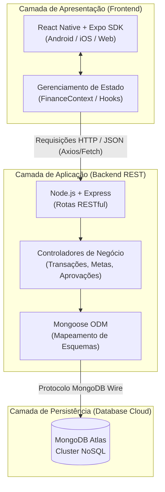
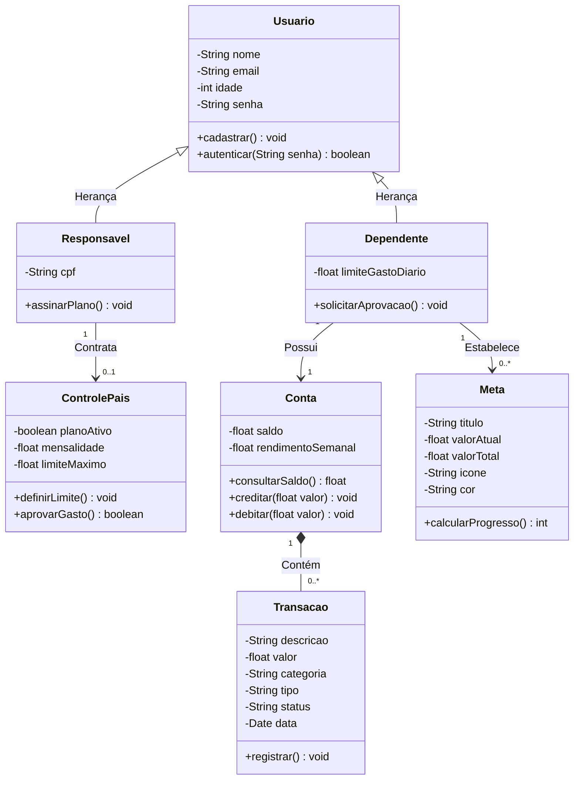

# 📘 Manual Técnico Parcial — FinTrack

**Projeto:** FinTrack — Aplicativo para educação financeira de crianças e adolescentes  
**Disciplina:** Práticas Extensionistas Integradoras III  
**Docente:** Profa. Ma. Laila Alves Santos  
**Equipe:**
- Gabriel de Almeida Rezende Nunes
- Guilherme de Oliveira Ferreira
- João Pedro Penna de Oliveira Silva
- João Vitor Dias de Almeida
- Thiago Alves do Nascimento
- Thúlio da Silva Alves

---

# SEÇÃO 1: ARQUITETURA DA SOLUÇÃO E MODELAGEM DE DADOS

## 1.1 Visão Geral da Arquitetura do Sistema

O **FinTrack** adota uma arquitetura em camadas baseada no modelo Cliente-Servidor (Client-Server Architecture) com separação clara entre a interface visual (frontend) e as regras de negócio (backend). O projeto foi organizado no padrão de repositório unificado (**Monorepo**), agrupando os módulos de frontend móvel/web e o servidor REST backend sob o mesmo ciclo de versionamento.

### Diagrama Arquitetural da Solução



### Componentes Principais da Arquitetura:

1. **Camada de Apresentação (`frontend/`):**
   - Construída utilizando **React Native com Expo SDK 52**, permitindo renderização nativa para smartphones e execução web no navegador a partir de uma única base de código em JavaScript ES6+.
   - Gerenciamento de estado reativo e centralizado através de Context API (`FinanceContext`), garantindo atualização instantânea do saldo, limites e fila de aprovações.
   - Navegação por abas focada na experiência do jovem (*Início, Metas, Aprender, Perfil*) com bloqueio de acesso do dependente às funções administrativas dos pais.

2. **Camada de Serviços / API (`backend/`):**
   - Construída sobre o ecossistema **Node.js com Express**, estruturada em camadas bem definidas: *Rotas (Routes)*, *Controladores (Controllers)* e *Modelos (Models)*.
   - Comunicação stateless via protocolo HTTP, utilizando JSON como padrão de intercâmbio de dados.
   - Mecanismo de contingência (fallback) em memória para execução e testes de bancada durante o desenvolvimento offline ou sem cluster MongoDB local.

3. **Camada de Persistência (Banco de Dados):**
   - Hospedada na nuvem através do **MongoDB Atlas**, provendo escalabilidade horizontal, alta disponibilidade e flexibilidade para modelos de dados de documentos hierárquicos (como o relacionamento entre dependentes e transações).

### Estrutura do Monorepo

```text
FinTrack/
├── frontend/                   # Aplicativo React Native (Expo SDK 52 / Web PWA)
│   ├── App.js                  # Casca responsiva e roteamento por perfil
│   ├── public/                 # Manifesto PWA, Service Worker e ícones
│   └── src/
│       ├── components/         # Componentes reutilizáveis (ex: BottomNavBar)
│       ├── context/            # Estado global reativo (FinanceContext)
│       └── screens/            # Telas do Dependente e Painel dos Pais
├── backend/                    # API RESTful (Node.js + Express + Mongoose)
│   └── src/
│       ├── config/             # Conexão com MongoDB Atlas e fallback em memória
│       ├── controllers/        # Regras de negócio (transações, metas, aprovações)
│       ├── models/             # Schemas Mongoose (Usuario, Conta, Transacao, Meta)
│       ├── routes/             # Definição dos endpoints REST
│       └── server.js           # Ponto de entrada do servidor HTTP
├── docs/                       # Documentação técnica, diagramas e requisitos
├── package.json                # Scripts unificados do monorepo (install:all, web, backend)
└── README.md                   # Apresentação pública e guia de execução
```

---

## 1.2 Justificativa Tecnológica (Alinhamento com a Matriz de Decisão)

A seleção tecnológica do FinTrack baseou-se em critérios quantitativos avaliados através de uma Matriz de Decisão Ponderada, onde o ecossistema **React Native + Node.js (JavaScript ES6+)** obteve a pontuação máxima de **100 pontos**, superando as alternativas *Flutter + Django* (96 pontos) e *Kotlin Nativo* (52 pontos).

Os fatores determinantes que orientaram a decisão arquitetural foram:

1. **Manutenibilidade (Peso 1 - Mais crítico):** A unificação do ecossistema técnico em JavaScript/ES6+ no Frontend e no Backend simplifica a evolução do software, reduz a necessidade de alternar entre linguagens diferentes e permite que qualquer membro da equipe trabalhe tanto no frontend quanto no backend.
2. **Curva de Aprendizado e Custo (Peso 2):** O conhecimento consolidado do grupo no ecossistema Web/JavaScript minimizou riscos de atraso de cronograma em comparação com o aprendizado simultâneo de linguagens como Dart e Python.
3. **Multiplataforma Ágil com Expo SDK:** O uso do Expo permite validação imediata em dispositivos móveis reais via *Expo Go* (leitura de QR Code) e execução web simultânea sem necessidade de emuladores pesados de Android Studio/Xcode.

---

## 1.3 Modelagem de Dados e Diagrama de Classes

A estrutura lógica do FinTrack fundamenta-se no paradigma orientado a objetos com herança e associações bem delimitadas, modelando os dois atores principais do sistema: o **Dependente** (criança/jovem) e o **Responsável** (pais).

### Diagrama de Classes UML



### Descrição das Entidades e Relacionamentos:

* **`Usuario` (Classe Base):** Reúne as credenciais e dados fundamentais de identificação (`nome`, `email`, `idade`, `senha`).
* **`Dependente` (Especialização de `Usuario`):** Representa o usuário final de educação financeira. Possui atributos operacionais como `limiteGastoDiario` e a operação `solicitarAprovacao()`.
* **`Responsavel` (Especialização de `Usuario`):** Representa o guardião/pai. Possui `cpf` para fins de assinatura e o método `assinarPlano()`.
* **`ControlePais` (Módulo Premium):** Ativado mediante contratação pelo Responsável, disponibiliza métodos de controle parental (`definirLimite()` e `aprovarGasto()`).
* **`Conta`:** Entidade vinculada unicamente ao Dependente, responsável por armazenar o saldo e executar as operações de adicionar (`creditar`) ou gastar (`debitar`).
* **`Transacao`:** Registros imutáveis de entradas e despesas vinculadas a uma Conta, possuindo controle de ciclo de vida (`Pendente`, `Aprovada`, `Negada`) para despesas solicitadas que demandem autorização parental.
* **`Meta`:** Registros de objetivos de poupança com barra de evolução proporcional (ex: Videogame, Bicicleta).

---

## 1.4 Rastreabilidade de Requisitos do Sistema

Para evidenciar o atendimento aos critérios de engenharia de software, o mapeamento entre os requisitos formais e os módulos implementados foi estruturado em duas categorias:

### A. Requisitos Funcionais (RF)

| Código | Requisito Oficial | Componente / Implementação Técnica |
|---|---|---|
| **RF01** | Cadastro de usuários e seleção de versão (Basic/Premium) | Modelagem pronta em `Usuario.js` (`Dependente` e `Responsavel` com campo `plano`). **Escopo parcial:** telas de Login e Cadastro com seleção automática de perfil planejadas para a **entrega final** (atualmente simulado pelo seletor de perfil no topo). |
| **RF02** | Estabelecimento de metas financeiras | `Meta.js`, tela `MetasScreen.js` e cards com barra de progresso proporcional no dashboard. |
| **RF03** | Registro e visualização de gastos diários | `NovaDespesaScreen.js` com teclado numérico em tela, categorização e display de limite. |
| **RF04** | Dicas financeiras inteligentes (IA) | Card "Dica do Dia com IA" integrado ao dashboard (`HomeScreen.js`). |
| **RF05** | Notificações e materiais educativos sobre finanças | `AprenderScreen.js` com minutagem de vídeos educativos e sistema de pontuação gamificada. |
| **RF06** | Operação em modo offline / contingência | Mecanismo de fallback em memória no backend e estado local via Context API. |
| **RF08** | Funcionalidades de controle parental (Premium) | `PainelPaisScreen.js`, rotas `/api/aprovacoes` e ações de aprovar/negar despesas em tempo real. |

### B. Requisitos Não Funcionais (RNF)

| Código | Requisito Oficial | Componente / Implementação Técnica |
|---|---|---|
| **RNF01** | Tempo de resposta inferior a 1 segundo | Arquitetura REST stateless com Node.js/Express e respostas JSON compactas. |
| **RNF02** | Interface intuitiva e interativa | Aplicativo React Native fiel ao protótipo de alta fidelidade do Figma, com componentes táteis e layout responsivo. |
| **RNF03** | Acesso por senha ou autenticação segura | Modelagem de credenciais e separação estrita de perfis prontas. **Escopo parcial:** fluxo visual de Login e autenticação via token planejados para a **entrega final** do projeto. |
| **RNF04** | Proteção e backup de dados em nuvem | Banco de dados hospedado em nuvem com réplicas e backup automatizado via MongoDB Atlas. |

---

# SEÇÃO 2: ESPECIFICAÇÃO DE SERVIÇOS (APIs) E PROCEDIMENTOS TÉCNICOS

## 2.1 Padrão Arquitetural da API RESTful

A camada de serviços do FinTrack foi concebida sob o padrão **REST (Representational State Transfer)**, operando de forma desacoplada do cliente frontend. As comunicações utilizam o protocolo HTTP/HTTPS, com dados enviados e recebidos formatados exclusivamente em **JSON (JavaScript Object Notation)**.

### Convenções Adotadas:
* **Métodos HTTP Semânticos:**
  * `GET`: Recuperação e consulta de recursos (apenas leitura, sem alterar dados no sistema).
  * `POST`: Criação de novos registros (novas transações e metas).
  * `PATCH`: Modificação parcial de recursos (aprovação ou negação de status de uma despesa).
* **Códigos de Resposta HTTP Padronizados:**
  * `200 OK`: Requisição processada com sucesso.
  * `201 Created`: Novo recurso criado com êxito.
  * `400 Bad Request`: Requisição inválida ou dados obrigatórios ausentes.
  * `404 Not Found`: Recurso não localizado pelo identificador.
  * `500 Internal Server Error`: Erro inesperado no processamento do servidor.

---

## 2.2 Catálogo e Especificação dos Endpoints

Abaixo estão detalhados os serviços disponibilizados pela API REST do FinTrack:

### 1. Verificação de Saúde da API
* **Rota:** `GET /api/health`
* **Descrição:** Rota de teste rápido para verificar se a API está online e funcionando.
* **Resposta Esperada (`200 OK`):**
```json
{
  "status": "online",
  "app": "FinTrack API",
  "version": "1.0.0",
  "timestamp": "2026-11-22T21:00:00.000Z"
}
```

---

### 2. Gestão de Transações
* **Listar Transações:** `GET /api/transacoes`
  * **Descrição:** Retorna o histórico de transações financeiras registradas.
  * **Resposta (`200 OK`):** Lista de transações com `id`, `descricao`, `valor`, `categoria`, `tipo` e `status`.

* **Cadastrar Nova Despesa:** `POST /api/transacoes`
  * **Descrição:** Registra uma nova solicitação de despesa criada pelo dependente (RF03).
  * **Corpo da Requisição (`Request Body`):**
```json
{
  "descricao": "Jogo Digital",
  "valor": 70.00,
  "categoria": "Jogos"
}
```
  * **Resposta (`201 Created`):**
```json
{
  "id": "6740ea318c",
  "descricao": "Jogo Digital",
  "valor": 70.00,
  "categoria": "Jogos",
  "tipo": "Despesa",
  "status": "Pendente",
  "data": "2026-11-22T21:00:00.000Z"
}
```

---

### 3. Gestão de Metas de Poupança
* **Consultar Metas:** `GET /api/metas`
  * **Descrição:** Retorna as metas de poupança cadastradas, com cálculo de progresso percentual (RF02).
  * **Resposta (`200 OK`):**
```json
[
  {
    "id": "1",
    "titulo": "Comprar um videogame novo",
    "valorAtual": 210.00,
    "valorTotal": 350.00,
    "porcentagem": 60,
    "cor": "#004590",
    "icone": "gamepad"
  },
  {
    "id": "2",
    "titulo": "Bicicleta nova",
    "valorAtual": 90.00,
    "valorTotal": 600.00,
    "porcentagem": 15,
    "cor": "#2b88c0",
    "icone": "bicycle"
  }
]
```

---

### 4. Controle Parental e Aprovações (Módulo Responsável - RF08)
* **Listar Solicitações Pendentes:** `GET /api/aprovacoes/pendentes`
  * **Descrição:** Retorna todas as solicitações de gastos aguardando decisão dos pais.

* **Aprovar Despesa:** `PATCH /api/aprovacoes/:id/aprovar`
  * **Descrição:** Atualiza o status da despesa para `Aprovada`, debitando o valor do saldo do dependente.
  * **Resposta (`200 OK`):**
```json
{
  "message": "Transação aprovada com sucesso!",
  "id": "1"
}
```

* **Negar Despesa:** `PATCH /api/aprovacoes/:id/negar`
  * **Descrição:** Rejeita a solicitação de gasto, mantendo o saldo inalterado.
  * **Resposta (`200 OK`):**
```json
{
  "message": "Transação negada.",
  "id": "1"
}
```

---

## 2.3 Procedimentos de Verificação e Validação Técnica

Para garantir a confiabilidade da entrega acadêmica e facilitar a avaliação pelo corpo docente, foram implementados os seguintes procedimentos operacionais:

1. **Teste Rápido da API (Smoke Test):**
   - Com o backend ativo (`npm run backend`), abra o navegador ou ferramenta de requisições no endpoint `http://localhost:3000/api/health`. A resposta em JSON confirma que o servidor está rodando corretamente.
2. **Funcionamento Offline e Modo de Contingência (RF06):**
   - Caso o backend seja iniciado sem conexão com a internet ou sem o MongoDB local configurado, o servidor ativa automaticamente dados de teste em memória. Isso permite testar todas as telas e rotas de aprovação normalmente sem interrupção de serviço.
3. **Validação da Interface Gráfica:**
   - Com o comando `npm run web`, o servidor Metro empacota a aplicação React Native para o navegador, permitindo simulação imediata do comportamento mobile, teclado numérico em tela e alternância de papéis entre Filho e Responsável.
   - *Nota de compatibilidade:* A execução web foi adotada como ambiente padrão de avaliação para garantir compatibilidade universal e evitar conflitos de versão do aplicativo cliente Expo Go em celulares físicos (Android/iOS), cuja atualização de SDK está planejada para as próximas etapas de manutenção do projeto.
